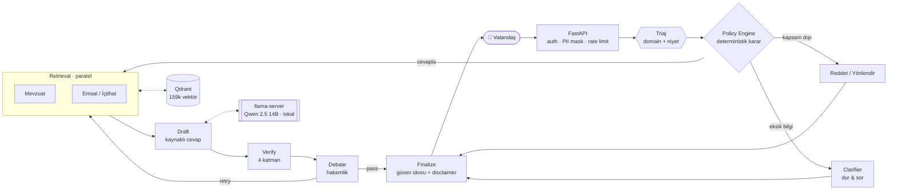
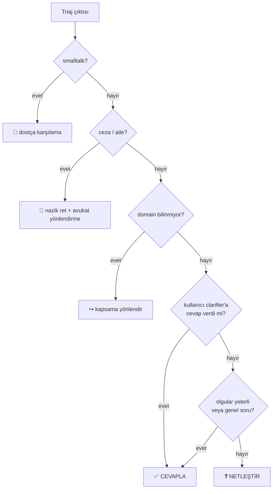
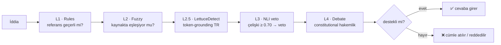

<div align="center">

# ⚖️ ADALET-AGENT

### Türkçe hukuk için kaynaklı, doğrulamalı ve lokal çalışan çoklu-ajan yapay zeka asistanı

*Uydurmayan hukuk asistanı — her iddiayı gerçek mevzuat ve içtihada bağlar, bağlayamadığını dürüstçe reddeder.*

[](https://github.com/cozalss/adalet-agent/actions/workflows/backend-ci.yml)
[](https://python.org)
[](https://fastapi.tiangolo.com)
[](https://langchain-ai.github.io/langgraph/)
[](https://qdrant.tech)
[](#-test-ve-kalite)
[](LICENSE)

**159k kaynak vektörü · 1135 backend + 149 frontend test · 8 hukuk alanı · 4 katmanlı doğrulama · production'da bulut LLM yok**

`Durum:` backend · retrieval · doğrulama · eval · web sohbet arayüzü **olgun** &nbsp;·&nbsp; mobil / landing **yol haritasında**

</div>

> [!WARNING]
> **Hukuki tavsiye değildir.** Sistem bilgilendirme amaçlıdır; somut uyuşmazlıkta avukata danışılmalıdır.

---

## 🎯 Sorun

Genel amaçlı LLM'ler (ChatGPT, Gemini) hukukta **tehlikelidir**: olmayan kanun
maddesi, uydurma Yargıtay kararı ve hayalî tarih üretirler — üstelik tam bir
özgüvenle. Avukata erişemeyen vatandaş bu yanlış bilgiye güvenir.

**ADALET-AGENT bu sorunu mimari olarak çözer:** cevabı üreten ajanın yanına, her
hukuki iddiayı **orijinal kaynağa karşı doğrulayan** bir ekip koyar. Doğrulanamayan
iddia kullanıcıya **gitmez**.

| | Genel amaçlı LLM | ⚖️ ADALET-AGENT |
|---|---|---|
| **Kaynak** | Hafızadan, doğrulanmaz | Her iddia gerçek mevzuat/karara `[src: …]` ile bağlı |
| **Uydurma madde** | Sık ve sinsi | Doğrulama katmanı yakalar → düşürür / reddeder |
| **Eksik bilgi** | Tahmin eder | **Durur ve takip sorusu sorar** (Clarifier) |
| **Kapsam dışı (ceza/aile)** | Riskli cevap verir | Nazikçe reddeder + doğru mercie yönlendirir |
| **Veri mahremiyeti** | Buluta gider | Tüm modeller **lokal** (Qwen + Whisper + Piper) |
| **Şeffaflık** | Kara kutu | Güven skoru + kaynak listesi + açık kaynak |

<details>
<summary>📋 <b>İçindekiler</b></summary>

- [Nasıl Çalışır?](#-nasıl-çalışır)
- [Karar Katmanı](#-karar-katmanı-policy--clarifier--composer)
- [Doğrulama Zinciri](#-doğrulama-zinciri)
- [Ölçülmüş Sonuçlar](#-ölçülmüş-sonuçlar)
- [Örnek Akış](#-örnek-akış)
- [Hızlı Başlangıç](#-hızlı-başlangıç)
- [Production Deploy](#-production-deploy)
- [API](#-api)
- [Teknoloji Yığını](#-teknoloji-yığını)
- [Test ve Kalite](#-test-ve-kalite)
- [Veri ve Eval](#-veri-ve-eval)
- [Klasör Yapısı](#-klasör-yapısı)
- [Güvenlik İlkeleri](#-güvenlik-i̇lkeleri)
- [Ekip & Akademik](#-ekip--akademik)
- [Teşekkür](#-teşekkür)

</details>

---

## 🧠 Nasıl Çalışır?

Bir soru, sabit bir RAG hattından değil; her adımı denetlenen bir **çoklu-ajan
grafiğinden** (LangGraph) geçer. *Soldan sağa: giriş → karar → retrieval →
doğrulama → finalize.*



| Aşama | Görev |
|---|---|
| **Triaj** | Soruyu 8 hukuk alanından birine atar, niyeti belirler, somut olguları çıkarır |
| **Policy Engine** | Üretimden önce *deterministik* karar: cevapla / netleştir / yönlendir / reddet (LLM yok) |
| **Mevzuat ∥ Emsal** | Paralel hibrit retrieval — kanun maddeleri + Yargıtay/Danıştay kararları |
| **Draft** | Yalnız getirilen kaynaklardan, her iddiayı `[src: …]` ile etiketleyerek cevap yazar |
| **Verify** | 4 katman: Rules → Fuzzy → LettuceDetect → NLI veto |
| **Debate** | Constitutional self-critique; pass / retry / reject |
| **Finalize** | Güven skoru hesaplar, doğrulanmamış cümleleri atar, disclaimer ekler |

**Kapsanan 8 sivil hukuk alanı:** 🛒 tüketici · 💼 iş · 🏠 kira · ⚖️ icra · 🚗 trafik · 🧾 vergi · 📜 tapu · 🏛️ idari
&nbsp;&nbsp;·&nbsp;&nbsp; **Kapsam dışı:** ceza & aile hukuku (etik/risk kararı → reddedilip yönlendirilir).

---

## 🚦 Karar Katmanı (Policy · Clarifier · Composer)

Sistemin omurgası, üretimden **önce** ne yapılacağına karar veren deterministik bir
katmandır. Bu sayede sistem; eksik bilgide tahmin yürütmek yerine **soru sorar**,
kapsam dışında **cevap uydurmak yerine yönlendirir**.



- **Policy Engine** (`agents/policy.py`) — `decide_path(state)` saf fonksiyon (LLM yok,
  aynı state → aynı karar). Karar eskiden 4 farklı düğüme dağılmıştı; tek, test
  edilebilir yere toplandı.
- **Clarifier** (`agents/nodes/clarifier.py`) — olgu eksikse domain başına **sabit
  soru bankasından** 2-4 Türkçe takip sorusu sorar ve durur. Retrieval/draft'a hiç
  girmediği için **sıfır halüsinasyon yüzeyi** (madde/karar numarası içermez).
  `CLARIFY_MARKER` loop-guard'ı sonsuz soru-sorma döngüsünü kapatır.
- **Composer** (`agents/nodes/compose.py`) — kapsam-dışı soruyu cevaplamadan sıcak bir
  yönlendirme metni üretir; hukuki cevap yolunda no-op.

---

## 🛡️ Doğrulama Zinciri

Her draft cümlesinden çıkarılan iddialar sırayla bu katmanlardan geçer. Amaç tek:
**kaynağa dayanmayan hiçbir hukuki iddia kullanıcıya ulaşmasın.**



| Katman | Yöntem | Yakaladığı |
|---|---|---|
| **L1 Rules** | regex | Geçersiz/sentaktik bozuk madde-karar referansı |
| **L2 Fuzzy** | rapidfuzz | Kaynakta karşılığı olmayan **uydurma atıf** |
| **L2.5 LettuceDetect** | TR token-grounding | Kaynakta desteklenmeyen cümle |
| **L3 NLI veto** | mDeBERTa XNLI | Kaynakla **çelişen** iddia (eşik 0.70) |
| **L4 Debate** | Constitutional self-critique | Bütünsel kalite + retry kararı |

> **Fail-closed:** `VERIFY_STRICT=1` iken doğrulayıcı çökerse cevap **reddedilir** —
> doğrulayıcı çalışmadıysa iddia "doğrulanmış" sayılamaz (SIFIR HALÜSİNASYON ilkesi).

---

## 📊 Ölçülmüş Sonuçlar

Aşağıdaki sayıların hepsi **gerçek ölçümdür** (tahmin/iddia değil). Metodoloji:
[docs/theses/measured-results.md](docs/theses/measured-results.md)

**Retrieval** (186 vaka benchmark):

| Domain @1 | Domain @5 | MRR | Keyword recall | Gecikme (hybrid) |
|:---:|:---:|:---:|:---:|:---:|
| **%81.2** | **%97.3** | 0.879 | %78.2 | ~260 ms |

**Doğrulama & Tahmin:**

| Verify ayırt-etme gücü¹ | Tahmin f1_macro | Kalibrasyon (ECE) | Corpus | Test / coverage |
|:---:|:---:|:---:|:---:|:---:|
| **+58.1 puan** | 0.825 | 0.0825 → **0.0109** | 159.362 vektör | 1135 ✓ / ≥%80 (CI kapısı) |

> ¹ Verify açıkken cevap claim-desteği %41.9, kapalıyken %100 → doğrulama katmanı
> kaynaksız iddiaların **%58.1**'ini işaretliyor (gerçek Qwen 2.5 14B, 8 vatandaş sorusu).

> **🔬 Mühendislik bulgusu:** Cross-encoder rerank, bu corpus ve vatandaş-dili
> sorgularında domain@1'i iyileştirmedi (%81.7 → %81.2) ama ~10× gecikme getirdi.
> Üretim yolu bu yüzden **domain-öncelikli tier-sort + hibrit arama** kullanır.
> Ayrıca corpus'taki dev chunk'lar nedeniyle reranker `max_length=512` ile
> sınırlandı → uçtan-uca gecikme **~5× düştü**.

---

## 💬 Örnek Akış

Çok-turlu konuşma — eksik bilgiyi netleştirip kaynaklı cevap üretme:

```text
👤 Kullanıcı : Kira depozitomu alamıyorum.

🤖 Asistan   : (Policy → clarify) Daha doğru yardımcı olabilmem için birkaç bilgiye
               ihtiyacım var:
               1. Kira sözleşmesi sona erdi mi, yoksa hâlâ devam ediyor mu?
               2. Evi tahliye edip ev sahibine teslim ettiniz mi?
               3. Ev sahibi bir gerekçe (hasar, ödenmemiş kira) sundu mu?

👤 Kullanıcı : Sözleşme geçen ay sona erdi, evi temiz teslim ettim,
               ev sahibi hiçbir gerekçe göstermiyor.

🤖 Asistan   : (Policy → answer · retrieval + verify + debate)
               **Kısa cevap:** Depozitonuzu geri isteyebilirsiniz; ev sahibinin
               gerekçesiz alıkoyması hukuka aykırıdır.
               **Dayanak:** TBK m.342 kira sözleşmesinde güvence bedelini düzenler [src: m-TBK-342].
               **Ne yapmalı:** 1) Ev sahibine yazılı (noter ihtarnamesi) talep gönderin.
               2) Sonuç alamazsanız sulh hukuk mahkemesinde alacak davası açın.

               ⚖️ Güven: %86 · Kaynak: TBK m.342 · ⚠️ Bu bir bilgilendirmedir.
```

---

## 🚀 Hızlı Başlangıç

**Gereksinimler:** Python 3.11 · [uv](https://docs.astral.sh/uv/) · Docker

```bash
# 1) Repoyu klonla + dev servisleri (Qdrant + Redis) başlat
git clone https://github.com/cozalss/adalet-agent.git
cd adalet-agent
docker compose -f docker-compose.dev.yml up -d

# 2) Backend'i mock LLM ile çalıştır (GPU/model gerekmez)
cd backend
uv sync --extra dev
export LLM_MODE=mock        # PowerShell:  $env:LLM_MODE="mock"
uv run uvicorn main:app --reload --port 8000
```

Swagger UI → `http://127.0.0.1:8000/docs` &nbsp;·&nbsp; Sağlık → `http://127.0.0.1:8000/health`

```bash
# 3) Testleri çalıştır
uv run --extra dev pytest tests/ -q       # 1135 passed, 6 skipped
uv run --extra dev ruff check .
uv run --extra dev mypy .
```

---

## 🏭 Production Deploy

Production profili tam yığını başlatır: **Qdrant · Redis · PostgreSQL · Backend ·
Caddy (TLS) · llama-server**.

**Ön koşullar:** NVIDIA GPU + `nvidia-container-toolkit` · `backend/models/` altında
GGUF model · `.env` içinde zorunlu secret'lar · Caddy TLS için DNS.

```bash
cp .env.example .env          # JWT_SECRET, POSTGRES_PASSWORD, REDIS_PASSWORD, QDRANT_API_KEY doldur
docker compose --profile production --env-file .env up -d
docker compose --profile production ps
```

Adımlar → [deploy-staging.md](docs/runbooks/deploy-staging.md) &nbsp;·&nbsp;
LLM kurulumu → [llm-production-setup.md](docs/runbooks/llm-production-setup.md)

---

## 🔌 API

| Method | Path | Auth | Açıklama |
|---|---|:---:|---|
| `GET` | `/health` | 🔓 | Derin sağlık kontrolü |
| `POST` | `/ask` | 🔒 | Ana hukuk asistanı cevabı |
| `POST` | `/ask/stream` | 🔒 | SSE ile aşamalı cevap (event sözleşmesi v1) |
| `DELETE` | `/ask/session/{id}` | 🔒 | Konuşma geçmişini temizler |
| `POST` | `/multimodal/ocr` · `/stt` · `/tts` | 🔒 | Belge OCR · ses→metin · metin→ses |
| `GET` / `DELETE` | `/api/dilekce/{conversation_id}` | 🔒 | Üretilen dilekçe PDF'ini indir / sil |
| `POST` | `/auth/invite/{code}` | 🔓 | Davet kodundan JWT üretir |
| `GET` | `/auth/me` | 🔒 | Kimlik bilgisi |
| `POST` | `/feedback` | 🔒 | Kullanıcı geri bildirimi |

<details>
<summary><b>Örnek istek + SSE event sözleşmesi</b></summary>

```http
POST /ask
Authorization: Bearer <jwt>
Content-Type: application/json

{ "question": "5 yıldır çalıştığım işten çıkarıldım, kıdem tazminatı alabilir miyim?" }
```

`/ask/stream` SSE event'leri (her biri `v: 1` şema sürümü taşır):
`triage` (intent + domain) → `clarify` → `sources` → `drafting` → `final` · hata → `error`

</details>

---

## 🧰 Teknoloji Yığını

| Katman | Teknolojiler |
|---|---|
| **API** | FastAPI · uvicorn · pydantic v2 · slowapi · structlog |
| **Orkestrasyon** | LangGraph · langchain-core |
| **Retrieval** | Qdrant · BGE-M3 (dense/sparse/ColBERT) · BM25 · RRF · rapidfuzz |
| **LLM (lokal)** | llama-cpp-python · Qwen 2.5 14B Q4_K_M (GGUF) |
| **Doğrulama/ML** | PyTorch (CUDA 12.4) · transformers · mDeBERTa NLI · LettuceDetect · scikit-learn |
| **Veri** | PostgreSQL (SQLModel + asyncpg + Alembic) · Redis |
| **Multimodal** | Tesseract (OCR) · faster-whisper (STT) · Piper (TTS) |
| **Dilekçe** | Jinja2 + ReportLab (PDF) |
| **Gözlem/Eval** | Langfuse · Ragas |

> **Production'da bulut LLM çağrısı yoktur.** Tüm üretim modelleri (Qwen, Whisper, Piper)
> lokal koşar — KVKK gereği veri Türkiye sınırlarında kalır.

---

## ✅ Test ve Kalite

```bash
cd backend
uv run --extra dev pytest tests/ -q                       # 1135 passed, 6 skipped
uv run --extra dev ruff check .                            # geniş strict kural seti
uv run --extra dev mypy .                                  # strict
uv run --extra dev bandit -r . -c pyproject.toml -ll -ii
uvx pip-audit --ignore-vuln CVE-2025-69872
```

CI ([backend-ci.yml](.github/workflows/backend-ci.yml)) her push'ta dört kapı koşar:
**lint + types** · **pytest + coverage gate (≥%80, son ölçüm ~%89)** · **pip-audit + bandit** · **Docker build smoke**.

---

## 🗃️ Veri ve Eval

```bash
cd backend
uv run python -m scripts.seed_mevzuat
uv run python -m scripts.seed_hf_yargitay --shards 0,1,2 --cap-per-domain 2000
uv run python -m eval.policy_eval        # karar-katmanı (clarify/multiturn/injection)
uv run python -m eval.draft_quality      # draft kalite (gerçek LLM ile)
```

| Eval seti | Vaka | Ölçtüğü |
|---|---:|---|
| `benchmark_v2.jsonl` | 186 | retrieval domain/keyword |
| `answer_cases.jsonl` | 100 | genel soru doğrudan cevaplanıyor mu (over-clarify kalkanı) |
| `verify_gold.jsonl` | 59 | doğrulama kalibrasyonu |
| `multiturn_cases.jsonl` | 50 | clarify → answer ilerlemesi |
| `out_of_scope_cases.jsonl` | 30 | ceza/aile/smalltalk yönlendirme |
| `prompt_injection_cases.jsonl` | 20 | prompt-injection dayanıklılığı |

---

## 📁 Klasör Yapısı

```text
adalet-agent/
├── backend/
│   ├── agents/        LangGraph düğümleri + policy · clarifier · compose
│   ├── api/           FastAPI routes, auth, PII, audit, limiter
│   ├── db/            PostgreSQL engine, modeller, repository (dosya-fallback)
│   ├── retrieval/     Qdrant, hybrid search, rerank, RAPTOR, GraphRAG
│   ├── verifier/      NLI, LettuceDetect, RARR
│   ├── multimodal/    OCR · STT · TTS
│   ├── predictive/    BERT-TR dava sonucu tahmini
│   ├── eval/          benchmark · policy_eval · draft_quality · ablation
│   └── tests/         pytest suite (1135+)
├── frontend/          Vite + React web arayüzü — /sor sohbet, SSE canlı akış (149 test)
├── mobile/            Flutter çalışma alanı — aktif ürün yüzeyi değil
├── docs/              mimari · ADR · runbook · tez dokümanları
├── infra/             Caddy ve deploy altyapısı
└── docker-compose.yml  · docker-compose.dev.yml
```

---

## 🔐 Güvenlik İlkeleri

- **Sıfır halüsinasyon** — kaynak uydurma yoktur; doğrulanamayan iddia reddedilir.
- Production'da `VERIFY_STRICT=1` ile **fail-closed** davranış.
- **Bulut LLM varsayılanı yoktur** (yalnız lokal model).
- Secret'lar hardcode edilmez; `.env` + secret guard.
- **PII maskeleme:** TCKN · telefon · e-posta · IBAN · plaka.
- Container hardening: read-only fs · cap-drop ALL · no-new-privileges.
- Test/örnek verilerde gerçek kişisel veri yoktur (sahte: "Ayşe Yılmaz" vb.).

---

## 🎓 Ekip & Akademik

**Çankaya Üniversitesi Yazılım Mühendisliği bitirme projesi.** Çok-disiplinli ekip,
dört çalışma alanına bölünmüştür:

| Alan | Sorumluluk |
|---|---|
| Backend & Çoklu-Ajan | LangGraph orkestrasyonu, policy/verify/debate |
| ML & Araştırma | Retrieval benchmark, tahmin modeli, değerlendirme |
| Web & Multimodal | Doğrulamalı RAG, OCR/citation, web yüzeyi |
| Mobil & Sesli | Flutter, sesli erişilebilir arayüz |

**Hedef yarışmalar:** TÜBİTAK 2209-A · Teknofest 2027 (Türkçe NLP / İnsanlık Yararına
Teknoloji). *Bu hedeflerdir; henüz kazanılmış bir derece beyan edilmemektedir.*

Tasarım hedefleri: hukuki doğruluk, kaynak gösterimi, ölçülebilir retrieval kalitesi
ve lokal veri işleme.

---

## 📜 Lisans

**MIT** — özgürce kullan, değiştir, dağıt. Ayrıntı için [LICENSE](LICENSE).

<div align="center">

---

**Bu projeyi yararlı buluyorsanız ⭐ vererek destekleyebilirsiniz.**

*Avukata erişemeyen herkes için, doğruyu söyleyen — ya da bilmediğini dürüstçe kabul eden — bir hukuk asistanı.*

</div>
