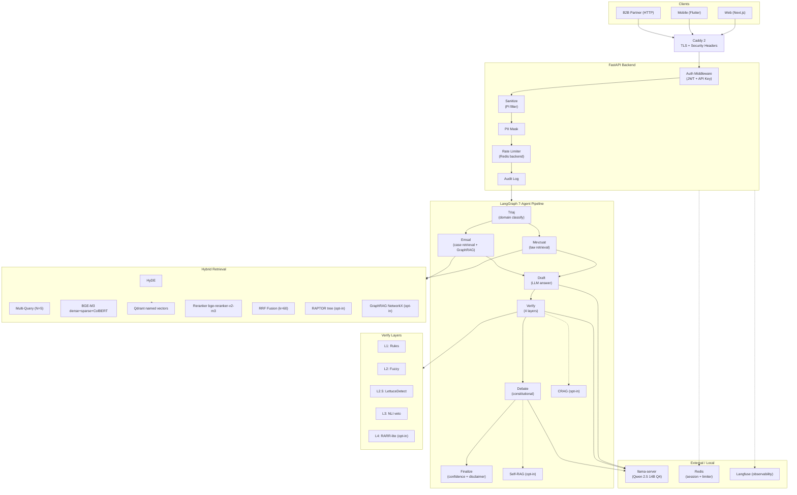
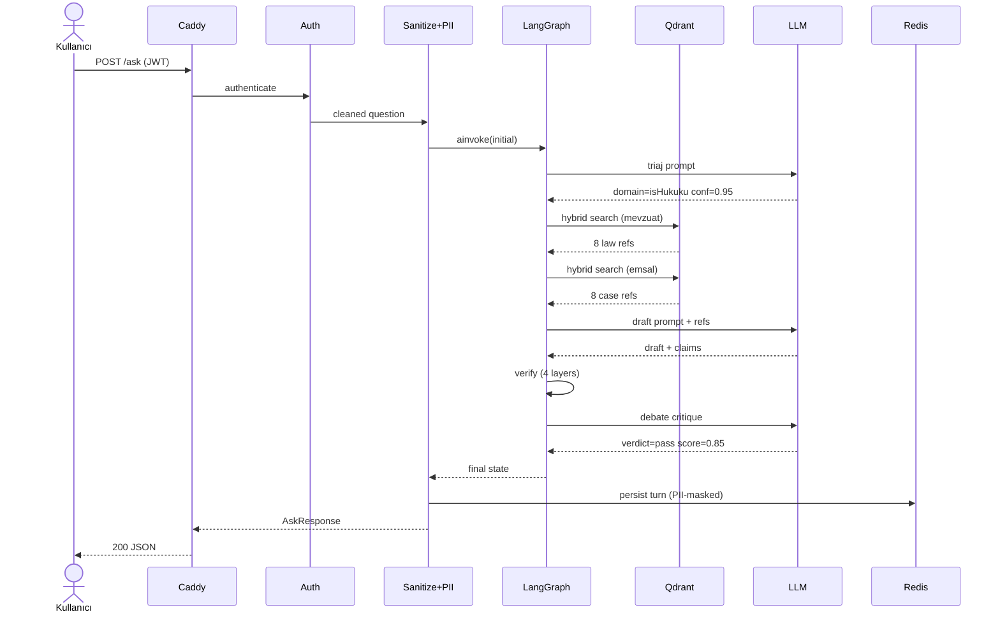
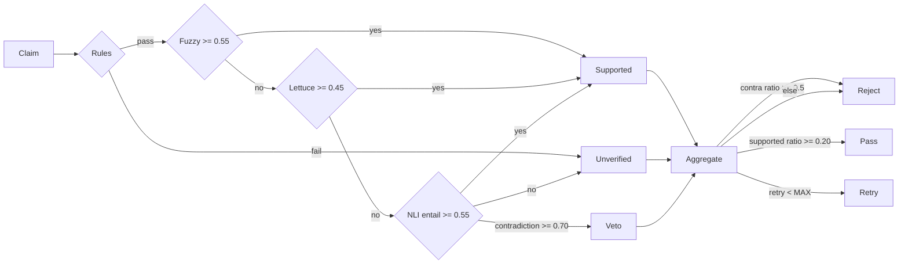
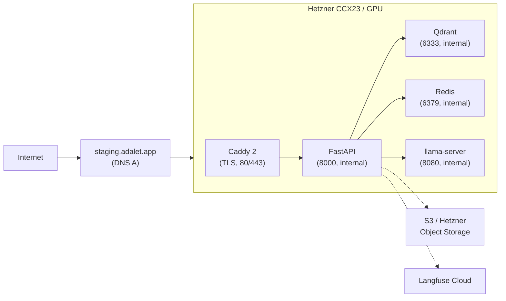

# ADALET-AGENT — System Architecture

> Sprint-4 Hafta 10 finalize. Doğrulamalı çoklu-ajan Türkçe hukuk RAG.

## Mimari Katmanlar (Mermaid)

## Veri Akışı — Tek Soru

## Verify Verdict Aggregation

## Deploy Stack (Hetzner Staging)

## Modüller (Backend)

| Dizin | Sorumluluk |
|---|---|
| `agents/` | LangGraph 12-node (triaj·mevzuat·emsal·draft·verify·debate·finalize + crag/self_rag/eligibility/tahmin/dilekçe) + state (merge_citations reducer) |
| `retrieval/` | Hybrid (BGE-M3 + RRF) + HyDE + Multi-Query + RAPTOR + GraphRAG + domain tier-sort |
| `verifier/` | NLI (mDeBERTa) + LettuceDetect + RARR |
| `db/` | PostgreSQL — engine + models + repositories (env-gated, dosya fallback) |
| `alembic/` | DB migration (async, DATABASE_URL'den) |
| `api/` | FastAPI routes + middleware (auth/sanitize/PII/audit/security-headers) |
| `api/routes/` | `/ask`, `/ask/stream`, `/multimodal/*`, `/auth/*`, `/feedback`, `/dilekce` |
| `core/` | Logging redact + PII-mask + observability (Langfuse) |
| `multimodal/` | OCR (Tesseract) + STT (Whisper) + TTS (Piper) |
| `predictive/` | Tahmin modeli (BERT-TR — eğitim bekliyor) |
| `eval/` | eval_run, freeze_baseline, edge_cases, ragas_full, judge |

## Önemli Sayılar (Sprint-4 Sonu)

| Metric | Sprint-3 sonu | Sprint-4 sonu (W10) |
|---|---|---|
| Test sayısı | 205 | 336 (+131) |
| Coverage | yok | 83.24% |
| mypy --strict | hayır | 0 hata (67 dosya) |
| ruff strict | hayır | 0 hata |
| Verify katman sayısı | 3 | 4 (RARR-lite) |
| Auth | yok | JWT + X-API-Key |
| TLS | yok | Caddy auto-TLS |
| PII mask | yok | TCKN, phone, email, IBAN, plate |
| Audit log | yok | structlog stream |
| CI/CD | manuel | GitHub Actions (4 job) |
| Container hardening | non-root | read-only fs, cap-drop ALL |

### Güncel (Sprint-6+ — 2026-05)

| Metric | Değer |
|---|---|
| Test sayısı | **662** |
| mypy --strict | 0 hata (**215 dosya**) · ruff ✅ · bandit ✅ |
| Corpus | **159k vektör** (8 domain; 62k→159k) |
| Retrieval | **domain@1 %81.2 · @5 %97.3 · MRR 0.88** (186 vaka, ölçüldü) |
| İlişkisel DB | **PostgreSQL** (feedback/api_key/audit, env-gated, Alembic) |
| Verify katman | 4 (fuzzy + LettuceDetect + NLI + debate) |
| Retry | re-retrieve (mevzuat+emsal, MAX_RETRY guard) + dedup reducer |

Ayrıntı: [theses/measured-results.md](theses/measured-results.md)

## Karar Bağlantıları (ADR)

- ADR-001: [NLI threshold 0.70](decisions/ADR-001-nli-contradiction-threshold.md)
- ADR-002: [LLM_MODE split](decisions/ADR-002-llm-mode-split.md)
- ADR-003: [ColBERT default on](decisions/ADR-003-colbert-enable-default.md)
- ADR-004: [RAPTOR + GraphRAG opt-in](decisions/ADR-004-raptor-graphrag-opt-in.md)
- ADR-005: [JWT + API key](decisions/ADR-005-jwt-vs-api-key.md)
- ADR-006: [PII mask hibrit](decisions/ADR-006-pii-mask-vs-redact.md)
- ADR-007: [Caddy auto-TLS](decisions/ADR-007-caddy-auto-tls.md)
- ADR-008: [Programmatic benchmark](decisions/ADR-008-benchmark-programmatic.md)
