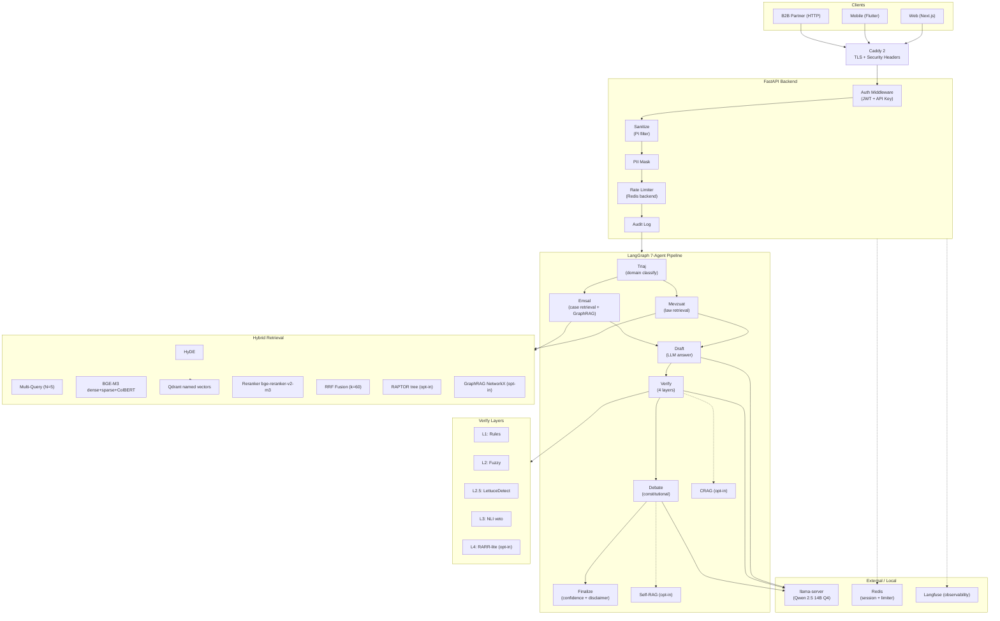
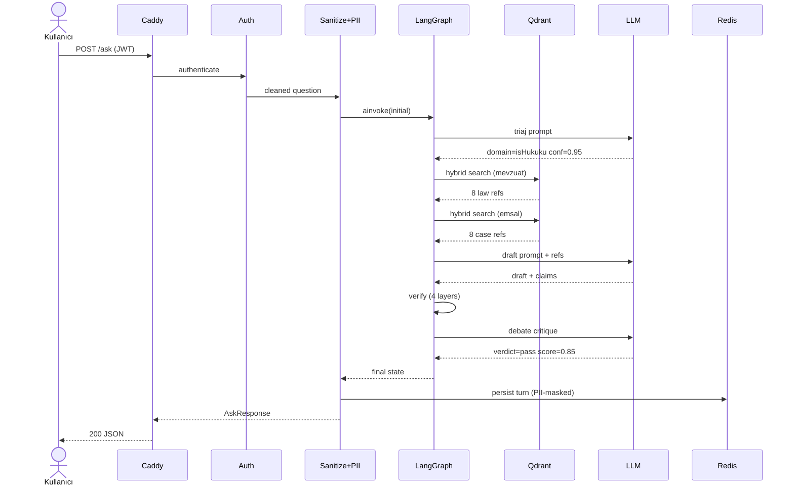
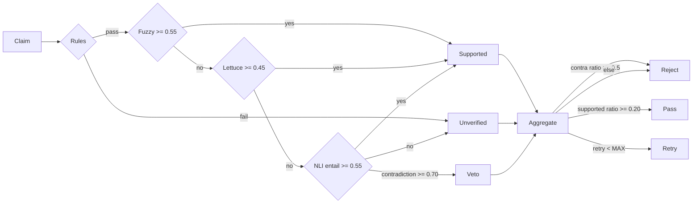
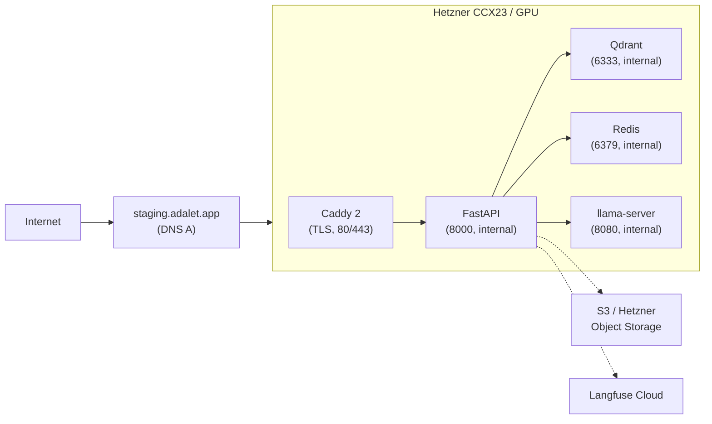

# ADALET-AGENT — System Architecture

> Doğrulamalı çoklu-ajan Türkçe hukuk RAG. Sprint-4 baseline + V2 karar katmanı
> (Policy Engine + Clarifier + Composer, 2026-05).

## Mimari Katmanlar (Mermaid)



## Veri Akışı — Tek Soru



## V2 Karar Katmanı — Policy Engine + Clarifier + Composer

Sprint-4 boru hattı her soruyu doğrudan retrieval→draft'a sokuyordu. V2, üretimden
ÖNCE "ne yapmalı?" kararını tek bir deterministik yere topladı (`agents/policy.py`,
**LLM yok**) ve eksik-bilgi / kapsam-dışı durumları boru hattına girmeden ele aldı.

### ResponseIntent

Triaj artık domain'in yanı sıra bir `response_intent` üretir (`agents/state.py`):

| intent | anlamı | sonuç |
|--------|--------|-------|
| `legal_answer` | normal hukuki soru | retrieval → draft → verify → debate |
| `smalltalk` | selamlaşma/teşekkür | LLM'siz hazır dostça yanıt |
| `out_of_scope_sensitive` | ceza/aile hukuku | sıcak ret + avukat yönlendirme |
| `redirect_to_scope` | hukuk-dışı soru | composer ile doğal yönlendirme |
| `needs_clarification` | eksik bilgili durumsal şikâyet | clarifier 2-4 soru sorar, durur |

### decide_path (deterministik merdiven)

`policy.decide_path(state)` saf fonksiyondur (aynı state → aynı karar):

```
1. intent == smalltalk             → "smalltalk"
2. intent == out_of_scope_sensitive→ "reject_sensitive"
3. domain == unknown               → "redirect"
4. clarification_round >= 1         → "answer"  (loop-guard: sonsuz soru-sorma kapanır)
5. kullanıcı clarifier'a cevap verdi (chat_history'de CLARIFY_MARKER) → "answer"
6. olgular yeterli (REQUIRED_FACTS + MIN_FACTS_FOR_ANSWER) → "answer"
7. soru genel/tanımsal ("nedir", "nasıl hesaplanır") → "answer"
8. aksi (olgu-eksik durumsal şikâyet) → "clarify"
```

### Clarifier (dur-ve-sor dalı)

`policy` "clarify" derse graph `clarifier_node`'a girer; retrieval/draft/verify'a
HİÇ dokunmadan finalize'a akar. Sorular domain başına SABİT bir bankadan gelir
(`QUESTION_BANK`) → **sıfır halüsinasyon yüzeyi** (hiç madde/karar numarası yok).
Render edilen metin `CLARIFY_MARKER` ile başlar; bir sonraki turda policy bu
marker'ı chat_history'de görür ve "answer"a geçer (döngü kapanır). Ek emniyet:
`MAX_CLARIFICATION_ROUNDS=1`.

**Multi-turn domain devralma:** turn-2 (kullanıcı clarifier'ı yanıtlıyor) metni tek
başına net domain sinyali taşımayabilir ("Evet, sözleşme sona erdi"). triaj, önceki
asistan turu clarifier ise (`_answered_clarifier`) önceki domain'i devralır →
unknown→redirect tuzağı önlenir (multiturn t2-answer %45→%100).

### Composer

`compose_node` (`agents/nodes/compose.py`) karar VERMEZ; yalnız belirli
intent'lerde (şu an `redirect_to_scope`) kullanıcıya görünen metni LLM ile daha
doğal yazar. LLM başarısız/uygunsuz olursa deterministik `redirect_to_scope_fallback()`
metnine düşer. Hukuki cevap yolunda **no-op** (`return {}`) → baseline davranış korunur.

### Memory facts (hedef)

`case_facts` (triaj'ın çıkardığı somut olgular: sure, isci_sayisi, tutar, olay,
taraf, tarih) clarifier'ın hangi soruları soracağını ve policy'nin yeterlilik
kararını besler. Hedef: clarifier'a verilen cevapların `case_facts`'e turlar
arası birikmesi (şu an chat_history triaj prompt'una enjekte ediliyor; structured
persistence sonraki iterasyon).

### Güncellenmiş akış

```
triaj (domain + response_intent + case_facts)
   │
   ▼  decide_path(state)
   ├─ smalltalk / reject_sensitive → finalize (hazır metin)
   ├─ redirect                      → compose → finalize
   ├─ clarify                       → clarifier → finalize (sorular, durur)
   └─ answer                        → [mevzuat, emsal] → [eligibility?] → draft
                                         → verify → debate → [tahmin?/dilekçe?]
                                         → compose (no-op) → finalize
```

Bayraklar kapalı + intent=legal_answer iken topoloji Sprint-4 baseline ile birebir
aynı (compose legal yolda no-op). `eligibility` artık default OFF (lokal latency);
`ELIGIBILITY_ENABLED=1` ile açılır.

## Verify Verdict Aggregation



## Deploy Stack (Hetzner Staging)



## Modüller (Backend)

| Dizin | Sorumluluk |
|---|---|
| `agents/` | LangGraph node'ları (triaj·mevzuat·emsal·draft·verify·debate·finalize + crag/self_rag/eligibility/tahmin/dilekçe + **clarifier·compose**) + **policy.py** (deterministik decide_path) + state (merge_citations reducer, ResponseIntent) |
| `retrieval/` | Hybrid (BGE-M3 + RRF) + HyDE + Multi-Query + RAPTOR + GraphRAG + domain tier-sort + reranker (**max_length=512**, dev-chunk O(n²) fix) |
| `verifier/` | NLI (mDeBERTa) + LettuceDetect + RARR |
| `db/` | PostgreSQL — engine + models + repositories (env-gated, dosya fallback) |
| `alembic/` | DB migration (async, DATABASE_URL'den) |
| `api/` | FastAPI routes + middleware (auth/sanitize/PII/audit/security-headers) |
| `api/routes/` | `/ask`, `/ask/stream`, `/multimodal/*`, `/auth/*`, `/feedback`, `/dilekce` |
| `core/` | Logging redact + PII-mask + observability (Langfuse) |
| `multimodal/` | OCR (Tesseract) + STT (Whisper) + TTS (Piper) |
| `predictive/` | Tahmin modeli (BERT-TR — eğitim bekliyor) |
| `eval/` | freeze_baseline, edge_cases, ragas_full, judge, **policy_eval** (clarify/multiturn/kapsam-dışı karar doğruluğu) |

## Önemli Sayılar (Sprint-4 Sonu)

| Metric | Sprint-3 sonu | Sprint-4 sonu (W10) |
|---|---|---|
| Test sayısı | 205 | 336 (+131) |
| Coverage | yok | 83.24% |
| mypy --strict | hayır | 0 hata (67 dosya) |
| ruff strict | hayır | 0 hata |
| Verify katman sayısı | 3 | 4 (RARR-lite) |
| Auth | yok | JWT + X-API-Key |
| TLS | yok | Caddy auto-TLS |
| PII mask | yok | TCKN, phone, email, IBAN, plate |
| Audit log | yok | structlog stream |
| CI/CD | manuel | GitHub Actions (4 job) |
| Container hardening | non-root | read-only fs, cap-drop ALL |

### Güncel (Sprint-6+ — 2026-05)

| Metric | Değer |
|---|---|
| Test sayısı | **771** |
| mypy --strict | 0 hata · ruff ✅ · bandit ✅ |
| Corpus | **159k vektör** (8 domain; 62k→159k) |
| Retrieval | **domain@1 %81.2 · @5 %97.3 · MRR 0.88** (186 vaka, ölçüldü) |
| İlişkisel DB | **PostgreSQL** (feedback/api_key/audit, env-gated, Alembic) |
| Verify katman | 4 (fuzzy + LettuceDetect + NLI + debate) |
| Retry | re-retrieve (mevzuat+emsal, MAX_RETRY guard) + dedup reducer |
| **V2 karar katmanı** | **policy.py (decide_path) + clarifier + composer + ResponseIntent** |
| **E2E latency** | reranker max_length fix: **1040s→~200s** (dev-chunk O(n²) giderildi) |
| **policy_eval** | multiturn t2-answer **%100** (clarifier→answer geçişi); MockLLM harness |

Ayrıntı: [theses/measured-results.md](theses/measured-results.md)

## Karar Bağlantıları (ADR)

- ADR-001: [NLI threshold 0.70](decisions/ADR-001-nli-contradiction-threshold.md)
- ADR-002: [LLM_MODE split](decisions/ADR-002-llm-mode-split.md)
- ADR-003: [ColBERT default on](decisions/ADR-003-colbert-enable-default.md)
- ADR-004: [RAPTOR + GraphRAG opt-in](decisions/ADR-004-raptor-graphrag-opt-in.md)
- ADR-005: [JWT + API key](decisions/ADR-005-jwt-vs-api-key.md)
- ADR-006: [PII mask hibrit](decisions/ADR-006-pii-mask-vs-redact.md)
- ADR-007: [Caddy auto-TLS](decisions/ADR-007-caddy-auto-tls.md)
- ADR-008: [Programmatic benchmark](decisions/ADR-008-benchmark-programmatic.md)
